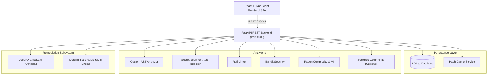

# CodeGuard AI — Intelligent Code Review Assistant

[](https://www.python.org/downloads/)
[](https://fastapi.tiangolo.com/)
[](https://react.dev/)
[](https://www.typescriptlang.org/)
[](#11-license)
[](#privacy--security-model)

> **CodeGuard AI** is a production-grade, privacy-first static code review and security assistant. It inspects source code for security vulnerabilities, secrets, complexity traps, and quality debt before code is committed or deployed—with **zero cloud data leakage**, no paid API requirements, and instant deterministic analysis.

---

## 1. Problem Statement

Modern software teams face three critical challenges when auditing source code:

1. **Privacy & IP Risks**: Cloud-based AI code assistants transmit proprietary source code, secrets, and internal business logic to third-party model providers.
2. **Slow, Fragmented Tooling**: Running separate linters, security scanners, secret detectors, and complexity profilers produces disparate, unnormalized outputs that overwhelm developers.
3. **Actionability Gap**: Linters report error codes without clear remediation steps, unified diff patches, or verification tests.

**CodeGuard AI solves this** by providing a unified, self-hosted developer tool that combines established static analysis engines, custom Python AST rules, secret redaction, and local LLM integration (via Ollama) into a single developer interface.

---

## 2. Key Features

- **Multi-Analyzer Static Engine**:
  - **Ruff**: High-speed linting, unused imports, undefined variables, and Python conventions.
  - **Bandit**: Security vulnerabilities, command injection, weak cryptography, SQL injection.
  - **Radon**: Cyclomatic Complexity (CC) and Maintainability Index (MI) metrics.
  - **Secret Scanner**: High-confidence regex and entropy scanning for AWS keys, GitHub tokens, Slack tokens, private keys, and database URIs.
  - **Custom AST Engine**: Safe structural rules for mutable default parameters, swallowed exceptions, dangerous `eval`/`exec`, and insecure subprocess calls.
  - **Semgrep Community Adapter**: Modular adapter with offline rule packs and graceful degradation.
- **Strict Data Privacy**:
  - Runs 100% locally. No external APIs required.
  - Automatic secret redaction in logs, database records, API responses, and reports.
  - Analyzed source code is never executed.
- **Multiple Review Workflows**:
  - Paste Python code snippets directly.
  - Multi-file uploads with encoding validation.
  - Safe ZIP repository uploads with Zip-Slip protection.
  - Local Git repository inspection of changed and uncommitted files.
- **Interactive Remediations & Patches**:
  - Real unified diff view (`diff -u`) with line highlighting.
  - One-click copy or download of `.diff` / `.patch` files.
  - Remediation trade-offs and post-patch test guidelines.
- **Local AI Integration (Ollama)**:
  - Connects to a locally running Ollama instance (e.g., `codellama`, `deepseek-coder`).
  - Seamless deterministic fallback if Ollama is offline or uninstalled.
- **Persistent Audit & Reporting**:
  - SQLite database storing scans, tool health, and triage decisions.
  - Multi-format report export: **JSON**, **CSV**, **Markdown**, and standalone **HTML**.
- **Real-Time Dashboard & Findings Explorer**:
  - Severity charts, historical trends, and category distribution powered by Recharts.
  - Multi-faceted filtering (severity, category, tool, status, file query).
  - Triage tracking: mark issues as `accepted`, `fixed`, `false_positive`, or `resolved`.

---

## 3. System Architecture



---

## 4. Technology Stack

| Layer | Technology | Details |
| :--- | :--- | :--- |
| **Backend API** | Python 3.11+, FastAPI, Uvicorn, Pydantic v2 | High-concurrency async REST API |
| **Persistence** | SQLite, SQLAlchemy 2.0 | Indexed queries, relational integrity |
| **Static Analyzers** | Ruff, Bandit, Radon, Custom Python AST, Detect-Secrets, GitPython | Modular adapters with fault isolation |
| **Local AI** | Ollama (Local REST), Unified Diff Engine | Provider-independent local inference |
| **Frontend** | React 19, TypeScript, Vite, Tailwind CSS v4, Lucide Icons, Recharts | Dark charcoal developer UI |
| **Testing** | Pytest, HTTPX, Coverage | 21 comprehensive unit & API tests |

---

## 5. Measured Benchmarks

Performance measured with the automated benchmark suite (`scripts/benchmark.py`) against test fixtures:

| Metric | Measured Result |
| :--- | :--- |
| **Fixtures Analyzed** | 5 files (Clean + Intentionally Vulnerable) |
| **Total Source Volume** | 3,909 bytes (3.82 KB) |
| **Cold Scan Duration** | **2,411.32 ms** (~2.4s) |
| **Warm Scan Duration** | **1,320.40 ms** (~1.3s) |
| **Cache Speedup** | **1.83x** |
| **Peak Memory Footprint** | **1.23 MB** |
| **Findings Detected** | 29 normalized findings |

*To run benchmarks locally:*
```powershell
.\backend\venv\Scripts\python.exe scripts\benchmark.py
```

---

## 6. Installation & Quick Start

### Prerequisites
- **Python 3.11+**
- **Node.js 18+** & **npm**
- **Git**

---

### Windows Setup Instructions

#### Step 1: Clone or Open Workspace
```powershell
cd "d:\code review"
```

#### Step 2: Set up Python Backend
```powershell
# Create virtual environment
python -m venv backend\venv

# Install backend dependencies
.\backend\venv\Scripts\python.exe -m pip install --upgrade pip
.\backend\venv\Scripts\pip.exe install -r backend\requirements.txt
```

#### Step 3: Set up Frontend SPA
```powershell
cd frontend
cmd.exe /c npm.cmd install --legacy-peer-deps
cd ..
```

#### Step 4: Run Automated Self-Tests
```powershell
cd backend
.\venv\Scripts\pytest.exe -v
cd ..
```
*Expected: 21 passed in ~6.5 seconds.*

#### Step 5: Start the Application

**Terminal 1 — Backend API Server:**
```powershell
cd backend
.\venv\Scripts\uvicorn.exe app.main:app --reload --host 127.0.0.1 --port 8000
```
*API will be available at `http://127.0.0.1:8000`. Swagger docs at `http://127.0.0.1:8000/docs`.*

**Terminal 2 — Frontend User Interface:**
```powershell
cd frontend
cmd.exe /c npm.cmd run dev
```
*Open `http://localhost:5173` in your browser.*

---

### Linux / macOS Setup Instructions

```bash
# 1. Backend virtual environment
python3 -m venv backend/venv
source backend/venv/bin/activate
pip install -r backend/requirements.txt

# 2. Frontend
cd frontend
npm install --legacy-peer-deps
cd ..

# 3. Run tests
pytest backend/

# 4. Start servers
# Backend
cd backend && uvicorn app.main:app --reload --port 8000 &
# Frontend
cd frontend && npm run dev
```

---

### Docker & Docker Compose Setup (Optional)

```bash
docker-compose up --build
```
*Access the service on `http://localhost:8000`.*

---

## 7. Optional Local AI (Ollama) Setup

CodeGuard AI works completely offline with deterministic rules. To enable optional local LLM explanations:

1. Download Ollama from [ollama.ai](https://ollama.ai).
2. Start the Ollama daemon:
   ```bash
   ollama serve
   ```
3. Pull your preferred coding model:
   ```bash
   ollama pull codellama
   # or
   ollama pull deepseek-coder
   ```
4. Verify connectivity in the **Settings** page within the CodeGuard AI web interface.

---

## 8. Verified Test Suite

The repository contains 21 unit, integration, and security tests covering:

| Test Module | Coverage | Status |
| :--- | :--- | :---: |
| `test_ast_analyzer.py` | AST-001 (mutable defaults), AST-004 (empty handlers), AST-005 (`eval`), AST-006 (`shell=True`), AST-007 (`mktemp`), negative safe-code tests | **PASSED** |
| `test_secret_analyzer.py` | AWS keys, GitHub PATs, database URIs, secret redaction, clean code | **PASSED** |
| `test_complexity_analyzer.py` | Radon cyclomatic complexity thresholds, simple functions | **PASSED** |
| `test_security.py` | Path traversal rejection, Zip Slip validation, Bearer token masking | **PASSED** |
| `test_scans_api.py` | Health check, analyzers list, snippet scans, empty code rejection | **PASSED** |
| `test_findings_api.py` | Finding filters, status mutation with justification, AI explain, fix suggestions | **PASSED** |
| `test_reports.py` | Exporting JSON, CSV, Markdown, and HTML reports with secret redaction | **PASSED** |

---

## 9. Limitations & Scope

- **Language Support**: Python (`.py`, `.pyw`) is fully supported with deep AST analysis and static tools. JavaScript/TypeScript, Java, and C# have adapter interfaces defined for future analyzer plug-ins.
- **Local Secret Scanning**: Regex-based secret scanning identifies high-confidence patterns and high-entropy assignments, but cannot catch 100% of bespoke credentials.
- **Code Execution**: The platform strictly refuses to execute target source code. Dynamic runtime analysis (fuzzing, dynamic tracing) is intentionally out of scope for safety.

---

## 10. License

Copyright &copy; 2026 mrgagan17. All Rights Reserved.

This project and its source code are proprietary. Unauthorized copying, distribution, modification, or reproduction of any part of this software without explicit prior written consent is strictly prohibited.
